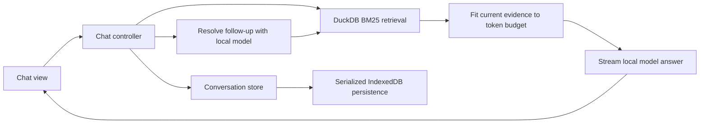

# RAGbox: Development Guide

RAGbox is a React and TypeScript application built with Vite. It uses GSAP for interface transitions, Zustand stores for shared state, DuckDB-Wasm for retrieval, and Transformers.js for local inference. Start with [installation](installation.md) to prepare a checkout and NFCorpus.

## Commands

Run commands from the repository root:

| Command | Purpose |
| --- | --- |
| `npm ci` | Install dependencies from the lockfile. |
| `npm run prepare:nfcorpus -- /path/to/corpus.jsonl` | Validate and prepare the static NFCorpus input. |
| `npm run dev` | Start Vite at `http://127.0.0.1:5173/` with a strict port. |
| `npm test` | Run the Vitest suite once. |
| `npm run test:browser` | Run Chromium checks for real index retrieval, source snapshots, reloads, mobile navigation, and reduced motion. |
| `npm run typecheck` | Check application, worker, test, and Node-script TypeScript configurations. |
| `npm run build` | Run type checks and build `dist/` for the default root path. |
| `npm run build -- --base=/ragbox/` | Run type checks and build for the Pages subpath. |
| `npm test -- test/collection-retrieval.test.ts` | Run a focused test file. |

Vitest runs the files under `test/`. Domain tests use a Node environment and focused browser API fakes. React integration tests use jsdom and Testing Library to exercise the rendered interface and its controller interactions. Runtime versions are pinned in [package.json](../package.json); use the supported Node range there.

The Playwright suite in `e2e/` starts or reuses the development server. It uses system Chromium when available; otherwise install a browser with `npx playwright install chromium`. Prepare NFCorpus first to run its full browser test. MS MARCO checks create a disposable five-passage database with the real FTS schema, so they do not download the full 3.35 GB artifact. In managed environments, `RAGBOX_FTS_WASM_PATH` and `RAGBOX_JSON_WASM_PATH` can point to official DuckDB extension files downloaded through the trusted network path. These test fixtures preserve browser TLS verification; normal runs fetch the official extension URLs.

## Request flow



The first message skips query rewriting. When no model is ready, the controller performs literal keyword retrieval and retains the results for inspection or a later answer. An empty result set produces an insufficient-evidence reply without answer generation.

For contextual follow-ups, the model receives bounded recent history and produces a standalone query. Retrieval then uses the selected saved index's analyzer and stopwords before a parameterized BM25 query. The answer worker fits the new evidence to its token budget, separates reasoning from final text, and reports allowed citation IDs. See [collections](collections.md#how-retrieval-works) and [the model guide](local-model.md#context-and-output-limits) for the actual limits.

## Source map

| Area | Files and responsibilities |
| --- | --- |
| Startup and navigation | [main.tsx](../src/main.tsx) mounts the React application. [App.tsx](../src/App.tsx) renders chat, collection selection, recent conversations, and workspace controls. [app-runtime.ts](../src/app-runtime.ts) initializes the headless database, index, model, and conversation services. |
| Retrieval | [collection-retrieval.ts](../src/collection-retrieval.ts) normalizes queries and executes BM25. [app-runtime.ts](../src/app-runtime.ts) prepares and reopens NFCorpus and coordinates [prebuilt-msmarco.ts](../src/prebuilt-msmarco.ts) and [download-prebuilt.ts](../src/download-prebuilt.ts) for the saved MS MARCO artifact. |
| Database lifecycle | [duckdb-bundle.ts](../src/duckdb-bundle.ts) imports the EH/MVP Wasm modules and classic workers as Vite asset URLs and selects a compatible local bundle. [open-local-database.ts](../src/open-local-database.ts) registers OPFS handles for the database and WAL before opening DuckDB. [load-coordinator.ts](../src/load-coordinator.ts) serializes resource initialization. |
| Model lifecycle | [model-service.ts](../src/model-service.ts) owns DOM-independent capability checks, loading, cancellation, and inference requests. The React interface subscribes to resource state published by the runtime; the older DOM adapters remain for compatibility tests. |
| Worker and prompts | [llm-worker.ts](../src/llm-worker.ts) loads the pinned model and handles rewriting, context fitting, and streaming. [rag.ts](../src/rag.ts) defines prompts, evidence/history fitting, query validation, and citation extraction. |
| Reasoning and budgets | [generation-output.ts](../src/generation-output.ts) separates reasoning and final output across streamed chunks. [generation-budget.ts](../src/generation-budget.ts) tracks separate limits. [thinking-effort.ts](../src/thinking-effort.ts) defines supported effort values. |
| Model cache | [model-cache.ts](../src/model-cache.ts) defines the model/revision and scoped cache operations. [model-readiness.ts](../src/model-readiness.ts) checks required files and metadata. |
| Conversation state | [conversations.ts](../src/conversations.ts) owns the Zustand store, versioned IndexedDB repository, migration, and retention. [conversation-persistence.ts](../src/conversation-persistence.ts) serializes saves and streaming checkpoints. |
| Chat orchestration | [chat-controller.ts](../src/chat-controller.ts) handles turn stages, retries, resource recovery, and cancellation. [types.ts](../src/types.ts) defines conversation, evidence, operation, and worker contracts. |
| React views and motion | [App.tsx](../src/App.tsx) renders transcripts, per-turn sources, the composer, recent chats, and collection/model controls. [example-queries.ts](../src/example-queries.ts) supplies starter questions. GSAP animations use scoped React lifecycle hooks and respect reduced-motion preferences. |
| Resource controls | [resource-state.ts](../src/resource-state.ts) provides shared resource snapshots and the operation gate. [app-runtime.ts](../src/app-runtime.ts) performs collection and model actions requested from the React workspace controls. |

The DuckDB workers and Wasm modules are emitted under Vite’s configured base path and served from the app’s origin. Startup does not wrap a remote DuckDB worker in a blob URL or depend on a worker/Wasm CDN. [app.css](../src/app.css) imports self-hosted DM Sans and Instrument Serif through Fontsource. The FTS extension, optional model files, and MS MARCO artifact still require their respective remote hosts; see [deployment](deployment.md#runtime-network-and-storage).

## State and lifecycle contracts

There is one active chat operation across the application. Conversation, turn, and attempt identities associate retrieval and worker events with their request. Late responses must be ignored after Stop, a collection change, New conversation, or opening another conversation.

Runtime workers, database connections, and abort controllers live outside persisted state. Conversation reads are pure. Unchanged turns retain object identity, and selector subscriptions keep draft/control changes from rerendering the transcript. Equivalent resource snapshots are deduplicated. The controller observes resource transitions directly, so resuming pending work does not depend on a view rendering first.

Persistence preserves ordering, one-second streaming checkpoints, migration markers, and retention of 50 nonempty conversations. Reload must restore interrupted turns as Stopped and must not restart inference. Opening workspace setup or Collections preserves ongoing work; changing collections cancels it. Retries reuse the turn and its submitted effort while rerunning only the stages required by the failure.

Prompt evidence is untrusted data. Render document and model output as text, bind query values through prepared statements, and limit citation links to the fitted evidence IDs. Keep reasoning out of copy output and follow-up context. These contracts are covered by the existing test suites and [chat validation](chat-validation.md).

## Feature configuration

The React sidebar always exposes recent saved conversations; it does not use the legacy `HISTORY_ENABLED` flag or a separate History route. The former first-visit tour and How it works page are not part of the React interface. Historical validation notes may refer to those older views.

`VITE_MSMARCO_INDEX_URL` changes the artifact URL at startup/build time. The expected size is a separate code constant. Model identity and revision are also code constants; changing them requires reviewing required cache files and template compatibility. See [deployment](deployment.md#configure-the-ms-marco-download) and [the model guide](local-model.md).

## Validation

For a normal change, run the checks relevant to the affected code. Before reviewing the full application or deployment path, use:

```sh
npm test
npm run typecheck
npm run build -- --base=/ragbox/
```

The build already runs type checking; the standalone command is useful for quicker diagnostics. Tests cover retrieval, orchestration, stale events, retries, model/cache recovery, reasoning parsing, token budgets, state subscriptions, persistence, and control behavior. Mocks cannot establish live answer quality or GPU compatibility.

For a supported-browser smoke check:

1. Prepare NFCorpus and verify retrieval and source inspection before loading the model.
2. With a real ready model, check an answer and a contextual follow-up, comparing factual claims with the cited snapshots.
3. Exercise Stop, Retry, draft editing, workspace setup, recent-chat navigation, collection switching, and reload restoration.
4. Check folded reasoning when present, copy output, source selection, keyboard focus, scrolling, a narrow viewport, and reduced-motion behavior.
5. Exercise the built application under `/ragbox/` to catch worker and dataset path errors. Test MS MARCO when a valid artifact is already available or an explicit download is intended.

Use the detailed [existing checklist](chat-validation.md#repeatable-manual-checks) with its historical UI differences in mind. Run destructive storage checks only with disposable browser data. The [experiment notes](experiments.md) retain earlier scaling measurements; label new observations with browser, device, collection, and model revision instead of treating a single run as a benchmark.

[Documentation](README.md)
